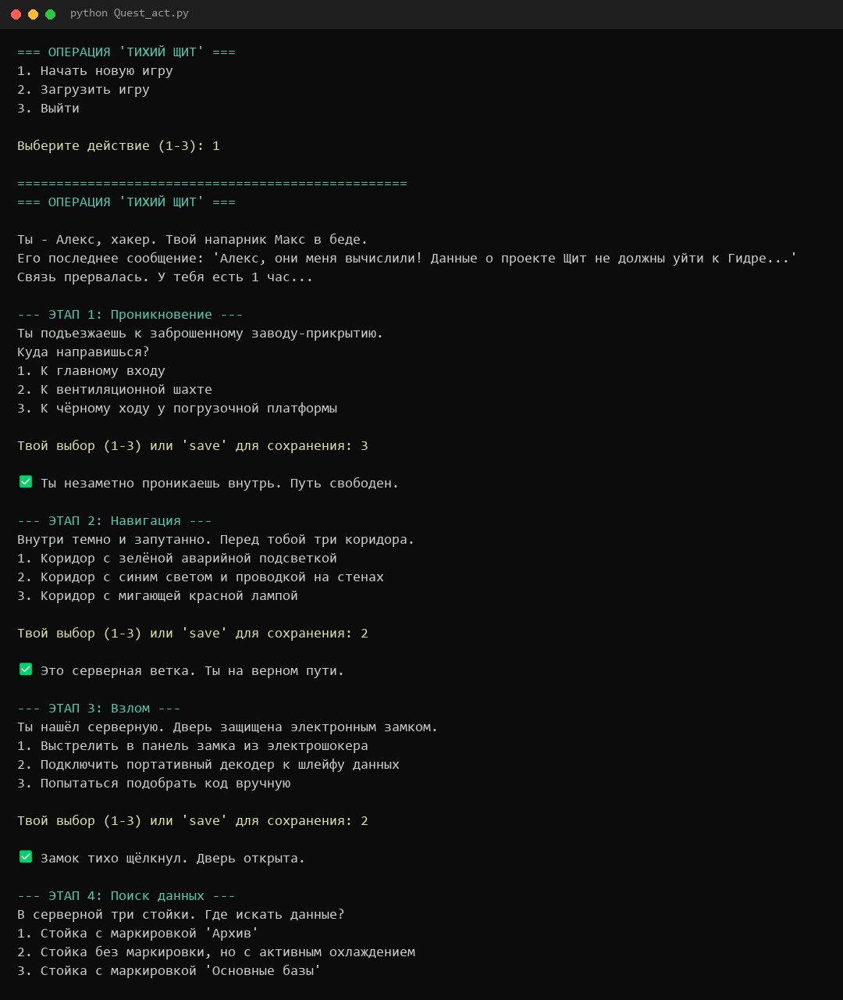

# 🕵️ Операция «Тихий щит»

Текстовый квест про хакера в консоли. Алекс должен пробраться на завод-прикрытие группировки «Гидра», найти данные проекта «Щит» и спасти напарника Макса. На каждом из 10 этапов три варианта действий, и верный только один.




## Особенности

- 10 этапов: проникновение, навигация, взлом, поиск данных, скрытность, загрузка, побег, уход, распространение и финал;
- варианты ответов перемешиваются при каждом прохождении, так что верный ответ не запомнить по номеру;
- сохранение и загрузка: в любой момент введите `save`, прогресс запишется в `game_save.json`;
- эффект «печатающегося» текста;
- статистика выборов в конце игры;
- только стандартная библиотека Python, ставить ничего не нужно.

## Запуск

```bash
git clone https://github.com/Naruto456y/cyber-quest.git
cd cyber-quest
python Quest_act.py
```

## Сборка exe

```bash
pip install pyinstaller
pyinstaller Quest_act.spec
```

Готовый `Quest_act.exe` с иконкой появится в `dist/`.

## Структура

```
Quest_act.py      игра
Quest_act.spec    конфигурация PyInstaller
KIber_game.jpeg   иконка
docs/             скриншот для README
```

## Автор

Yusuf ([@Naruto456y](https://github.com/Naruto456y)). Лицензия [MIT](LICENSE).
